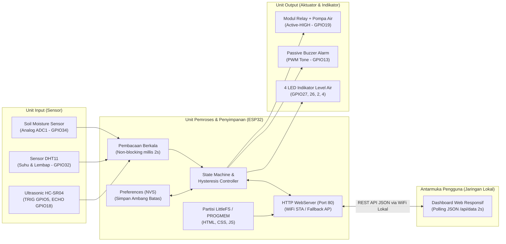

# Diagram Blok Sistem — Smart Garden Guard

Diagram blok di bawah ini menggambarkan arsitektur perangkat keras (sensor dan aktuator pada board `IoT/Code_test`), unit pemrosesan utama ESP32, penyimpanan non-volatil (NVS & LittleFS), serta komunikasi HTTP REST API ke dashboard web di jaringan lokal.

