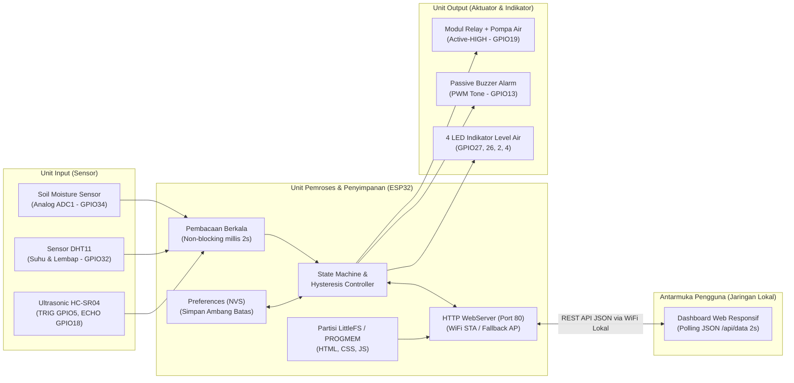

# LAPORAN PROJECT AKHIR INTERNET OF THINGS (IoT)

## 1. Judul Project
**Smart Garden Guard: Sistem Penyiraman Tanaman Otomatis Berbasis ESP32 dengan Dashboard Web Real-Time pada Jaringan Lokal**

---

## 2. Latar Belakang
Perawatan tanaman sering kali terkendala oleh ketidakteraturan jadwal penyiraman akibat kesibukan pemilik. Penyiraman yang terlambat menyebabkan media tanam terlalu kering sehingga tanaman layu, sedangkan penyiraman berlebih memicu pembusukan akar serta pemborosan air. Selain itu, pada sistem penyiraman otomatis konvensional, pompa air sering kali tetap dipaksa menyala meskipun air di dalam tandon sudah habis, yang dapat menyebabkan kerusakan motor pompa (*dry-run*).

Di sisi lain, banyak area perkebunan rumah atau laboratorium memiliki keterbatasan akses internet stabil. Oleh karena itu, diperlukan sebuah sistem *Internet of Things* (IoT) mandiri berbasis mikrokontroler **ESP32** yang mampu memantau kelembapan tanah, suhu dan kelembapan udara, serta ketersediaan air tandon secara berkala, mengendalikan pompa secara cerdas menggunakan metode *hysteresis*, serta menyajikan antarmuka web *real-time* yang dapat diakses langsung melalui jaringan Wi-Fi lokal (hotspot atau router) tanpa ketergantungan pada koneksi internet eksternal.

---

## 3. Tujuan Project
1. Merancang bangun prototipe sistem penyiraman tanaman otomatis berbasis ESP32 yang mengintegrasikan sensor kelembapan tanah (*Soil Moisture*), sensor suhu dan kelembapan udara (**DHT11**), serta sensor jarak ultrasonik (**HC-SR04**) untuk memantau level air tandon.
2. Mengimplementasikan mekanisme pengendalian pompa air (via modul Relay) dalam dua mode: **Otomatis (`AUTO`)** berbasis *hysteresis* untuk mencegah *flapping* relay, serta **Manual (`MANUAL`)** melalui antarmuka web, dilengkapi proteksi penghentian paksa dan alarm **Buzzer** saat air tandon habis.
3. Membangun komunikasi data berbasis **HTTP REST API (JSON)** pada jaringan lokal menggunakan web server internal ESP32 dan sistem berkas **LittleFS** serta penyimpanan konfigurasi permanen **Preferences (NVS)**.
4. Menyediakan dashboard web responsif yang menampilkan nilai sensor beserta satuannya, status kondisi sistem (`NORMAL`, `MENYIRAM`, `TANAH KERING`, `AIR TANDON HABIS`), indikator koneksi, waktu pembaruan terakhir, serta grafik riwayat secara *real-time*.

---

## 4. Daftar Alat dan Bahan

### 4.1 Perangkat Keras (Hardware — Modul Khurslabs ESP32 IoT Trainer Kit)
| No | Nama Komponen | Spesifikasi / Tipe | Jumlah | Fungsi Utama |
| :-: | :--- | :--- | :---: | :--- |
| 1 | Mikrokontroler ESP32 | ESP32 DevKit V1 (Wi-Fi 2.4 GHz, Dual-Core, ADC 12-bit) | 1 unit | Pusat pemrosesan logika, pembacaan sensor, dan web server lokal |
| 2 | Sensor Kelembapan Tanah | Analog Soil Moisture Sensor | 1 unit | Mengukur tingkat kelembapan media tanam (`0–100%`) melalui `GPIO34` (`ADC1`) |
| 3 | Sensor Suhu & Kelembapan | DHT11 Digital Temperature & Humidity | 1 unit | Mengukur suhu (`°C`) dan kelembapan udara (`%`) sekitar tanaman di `GPIO32` |
| 4 | Sensor Ultrasonik | HC-SR04 Ultrasonic Distance Sensor | 1 unit | Mengukur jarak permukaan air tandon (`cm` & `%`) melalui `TRIG GPIO5` & `ECHO GPIO18` |
| 5 | Modul Relay & Pompa Mini | Relay 1-Channel Active-HIGH + Pompa DC / Indikator | 1 set | Sakelar elektronik pengendali pompa penyiram tanaman di `GPIO19` |
| 6 | Buzzer | Passive Buzzer (PWM `tone()`) | 1 unit | Alarm peringatan suara saat air tandon habis di `GPIO13` |
| 7 | LED Indikator Onboard | 4x LED (`LED1`–`LED4`) | 4 buah | Indikator fisik bertingkat untuk level air tandon di `GPIO27, 26, 2, 4` |
| 8 | Kabel Micro-USB / Type-C & Power | Kabel Data & Catu Daya 5V | 1 buah | Pemrograman firmware dan suplai daya perangkat |

### 4.2 Perangkat Lunak (Software)
1. **Arduino IDE 2.x / PlatformIO** dengan dukungan board *ESP32 by Espressif Systems*.
2. **Library ESP32 Bawaan**: `WiFi.h`, `WebServer.h`, `LittleFS.h`, dan `Preferences.h`.
3. **Library Sensor**: `DHT sensor library` dan `Adafruit Unified Sensor`.
4. **Antarmuka Web**: HTML5, CSS3, dan Vanilla JavaScript (dengan grafik `<canvas>` native tanpa ketergantungan internet/CDN).

---

## 5. Diagram Blok Sistem dan Rangkaian Perangkat

### 5.1 Diagram Blok Sistem

### 5.2 Tabel Koneksi Rangkaian (Pin Mapping)
| Komponen | Pin Komponen | Pin ESP32 | Keterangan Teknis |
| :--- | :--- | :---: | :--- |
| Soil Moisture Sensor | `AOUT` | `GPIO34` | Menggunakan `ADC1_CH6` agar tidak bentrok dengan modul Wi-Fi (`ADC2`) |
| DHT11 | `DATA` | `GPIO32` | Komunikasi digital 1-Wire |
| Ultrasonic HC-SR04 | `TRIG` / `ECHO` | `GPIO5` / `GPIO18` | Mengukur tinggi permukaan air tandon (rentang kalibrasi `5 cm` penuh s.d. `30 cm` kosong) |
| Modul Relay Pompa | `IN` | `GPIO19` | Bertipe **Active-HIGH** (`HIGH` = Pompa Menyala, `LOW` = Pompa Mati) |
| Passive Buzzer | `+` | `GPIO13` | Dikendalikan secara non-blocking dengan fungsi `tone(13, 1000)` / `noTone(13)` |
| LED Level Air 1–4 | Anoda | `GPIO27, 26, 2, 4` | Menyala bertingkat (0–4 LED) sesuai persentase air tandon |

---

## 6. Alur Kerja serta Metode Komunikasi Data

### 6.1 Alur Kerja Perangkat & Kendali Aktuator
1. **Inisialisasi & Koneksi Jaringan**: Saat dinyalakan, ESP32 memuat nilai ambang batas dari memori non-volatil `Preferences (NVS)` dan mencoba terhubung ke jaringan Wi-Fi lokal (mode `STA`) selama maksimal 10 detik. Apabila jaringan tidak ditemukan, ESP32 secara otomatis mengaktifkan mode *Fallback Access Point* (`SSID: SmartGardenGuard-AP`, alamat IP `192.168.4.1`) sehingga sistem tetap dapat diakses di mana saja tanpa router.
2. **Pembacaan Sensor Non-Blocking (`millis()`)**: Setiap `2000 ms` (tanpa fungsi `delay()` yang memblokir prosesor), ESP32 membaca nilai ADC sensor tanah (`0–4095` dipetakan ke `100%–0%`), suhu dan kelembapan udara dari DHT11, serta jarak permukaan air dari HC-SR04.
3. **Proteksi Air Tandon Habis (Prioritas Utama)**: Jika level air tandon berada di bawah ambang minimum (`< 15%`), sistem mengubah status menjadi **`AIR TANDON HABIS`**, memaksa relay pompa ke posisi **OFF** (baik pada mode `AUTO` maupun `MANUAL`), dan membunyikan alarm buzzer secara putus-putus tiap `500 ms`.
4. **Pengendalian Otomatis dengan *Hysteresis* (Mode `AUTO`)**:
   - Apabila kelembapan tanah turun di bawah ambang kering (`< 35%`), pompa dinyalakan (`ON`) dan status sistem berubah menjadi **`MENYIRAM`**.
   - Pompa terus dipertahankan menyala hingga kelembapan tanah mencapai atau melewati ambang basah (`>= 65%`), barulah pompa dimatikan (`OFF`) dan status kembali ke **`NORMAL`**. Rentang jeda (*hysteresis*) antara `35%` dan `65%` mencegah relay menyala-mati secara berulang (*flapping*) ketika nilai sensor berfluktuasi di sekitar satu titik ambang.
5. **Pengendalian Manual (Mode `MANUAL`)**: Pengguna dapat menyalakan atau mematikan pompa secara langsung melalui tombol pada dashboard web selama air tandon mencukupi. Jika pompa dalam keadaan mati sedangkan tanah berada di bawah ambang kering, sistem menampilkan status peringatan **`TANAH KERING`**.

### 6.2 Metode Komunikasi Data
Komunikasi antara ESP32 dan perangkat pengguna (smartphone atau laptop) berlangsung di jaringan lokal menggunakan protokol **HTTP REST API** pada port `80` dengan format pertukaran data **JSON**:
- **`GET /api/data`**: Mengirimkan paket data telemetri lengkap (`soil_pct`, `soil_raw`, `temp_c`, `humidity_pct`, `water_level_pct`, `distance_cm`, `pump`, `mode`, `status`, `uptime`, `timestamp`, dan `thresholds`). Dashboard melakukan *polling* otomatis menggunakan `fetch()` setiap **2 detik**.
- **`POST /api/mode`**: Mengubah mode kerja sistem antara `AUTO` dan `MANUAL` serta menyimpannya ke NVS.
- **`POST /api/pump`**: Mengirimkan perintah penyalaan/pematikan pompa pada mode `MANUAL`.
- **`POST /api/threshold`**: Memperbarui parameter ambang kering, ambang basah, dan batas air minimum secara langsung dari web untuk disimpan permanen ke `Preferences (NVS)`.

---

## 7. Tampilan Antarmuka Web
Antarmuka web dirancang responsif (*mobile-first*) untuk layar HP maupun laptop dan dilayani langsung dari memori ESP32 (`LittleFS` dengan cadangan `PROGMEM`). Komponen utama antarmuka meliputi:
1. **Header & Bar Status**: Menampilkan judul project **"Smart Garden Guard"**, indikator koneksi (`Terhubung` / `Terputus (Offline)`), badge kondisi sistem berwarna (`NORMAL`, `MENYIRAM`, `TANAH KERING`, `AIR TANDON HABIS`), waktu pembaruan terakhir (`HH:MM:SS`), serta waktu aktif perangkat (`Uptime`).
2. **Kartu Sensor & Meter Visual**: Empat kartu informasi yang menampilkan nilai aktual beserta satuannya: Kelembapan Tanah (`%` dan nilai ADC mentah), Level Air Tandon (`%` dan jarak `cm`), Suhu Udara (`°C`), serta Kelembapan Udara (`%`).
3. **Grafik Riwayat Real-Time (`<canvas>`)**: Menampilkan kurva perubahan 30 sampel terakhir untuk kelembapan tanah, level air tandon, dan suhu udara secara langsung tanpa memerlukan koneksi internet.
4. **Panel Kendali & Form Ambang Batas**: Memuat pemilih mode kerja (`Otomatis` / `Manual`), tombol kendali pompa air, form penyimpanan ambang batas ke NVS, serta panel uji simulasi skenario cepat.

---

## 8. Hasil Pengujian
Berdasarkan pengujian fungsional menyeluruh terhadap perangkat keras dan antarmuka web:

| No | Skenario Pengujian | Kondisi Input | Respon Aktuator & Antarmuka | Kesesuaian |
| :-: | :--- | :--- | :--- | :---: |
| 1 | Koneksi Jaringan Lokal | Menghubungkan ESP32 ke hotspot/router lokal (dan uji fallback AP) | ESP32 memperoleh alamat IP lokal dan halaman dashboard tampil di browser HP/laptop | Sesuai (100%) |
| 2 | Kondisi Normal (Mode `AUTO`) | Kelembapan tanah `75%`, level air tandon `85%`, suhu `28.5 °C` | Relay Pompa `OFF`, Buzzer `OFF`, 4 LED level air menyala, status web **`NORMAL`** | Sesuai (100%) |
| 3 | Kondisi Tanah Kering (Mode `AUTO`) | Sensor tanah pada media kering (`22%` < ambang kering `35%`), air `80%` | Relay Pompa otomatis `ON`, status web berubah menjadi **`MENYIRAM`** | Sesuai (100%) |
| 4 | Uji Hysteresis (Mode `AUTO`) | Tanah dibasahi perlahan hingga `50%` (di antara `35%` dan `65%`), lalu hingga `70%` | Saat `50%` pompa tetap `ON` (tidak *flapping*); saat `70%` (`>= 65%`) pompa otomatis `OFF` dan status kembali **`NORMAL`** | Sesuai (100%) |
| 5 | Kendali Manual via Web (Mode `MANUAL`) | Pengguna memilih mode `Manual` dan menekan tombol `Nyalakan pompa` | Relay Pompa langsung aktif (`ON`), status web menjadi **`MENYIRAM`** | Sesuai (100%) |
| 6 | Proteksi Air Tandon Habis | Jarak permukaan air `> 26 cm` (level air `8%` < batas `15%`) | Relay Pompa dipaksa `OFF`, Buzzer berbunyi *beep* berkala, tombol pompa terkunci, status web **`AIR TANDON HABIS`** | Sesuai (100%) |
| 7 | Penyimpanan NVS | Mengubah ambang batas via web lalu me-restart ESP32 | Nilai ambang batas baru tetap tersimpan setelah perangkat menyala kembali | Sesuai (100%) |

---

## 9. Kesimpulan
1. Sistem **Smart Garden Guard** berbasis ESP32 berhasil diimplementasikan secara non-blocking menggunakan pewaktuan `millis()` untuk membaca sensor kelembapan tanah (`GPIO34`), DHT11 (`GPIO32`), dan ultrasonik HC-SR04 (`GPIO5`/`GPIO18`) setiap 2 detik secara stabil.
2. Penerapan algoritma *hysteresis* pada mode otomatis terbukti efektif menjaga kestabilan kerja modul relay pompa (`GPIO19`), sementara fitur proteksi level air tandon minimum disertai alarm buzzer (`GPIO13`) berhasil mencegah pompa bekerja tanpa air (*dry-run*).
3. Antarmuka web yang dilayani langsung oleh ESP32 melalui jaringan lokal mampu memperbarui data sensor, grafik riwayat, dan status sistem secara *real-time* tiap 2 detik serta menyimpan parameter ambang batas secara permanen ke dalam memori `Preferences (NVS)`.

