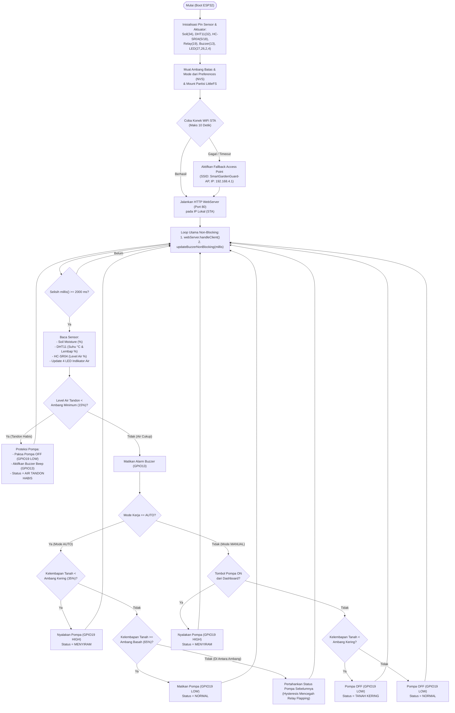

# Flowchart Alur Kerja Sistem — Smart Garden Guard

Flowchart berikut menjelaskan cara kerja *loop* non-blocking (`millis()`), proteksi level air tandon, mekanisme *hysteresis* pada mode `AUTO`, serta kendali `MANUAL` melalui antarmuka web.

